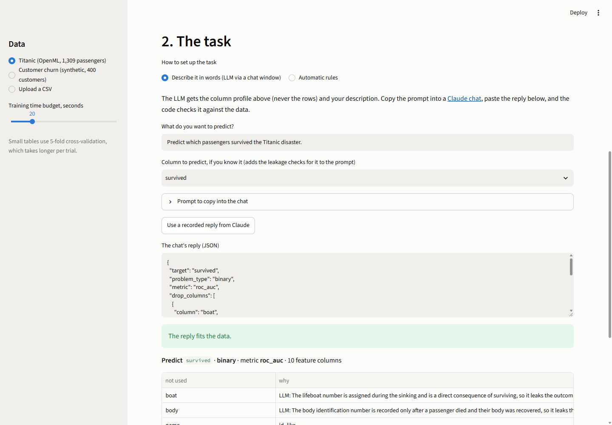
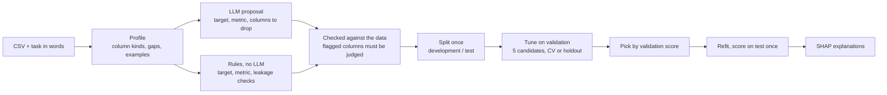

# AutoML

[](https://github.com/maksympostoiuk/AutoML/actions/workflows/ci.yml)

AutoML for tabular data that tries to be **honest** about what it finds. Give it a CSV and a
sentence ("predict which passengers survived"); it profiles the columns, lets an LLM decide
which columns would leak the answer, trains **XGBoost tuned with Optuna** next to simple
baselines, reports a test score that no choice has ever seen, and explains every prediction
with **SHAP**.

Built to learn gradient boosting properly: the repository also contains gradient boosting and
a small XGBoost **written from scratch**, which reproduce scikit-learn and `xgboost` exactly.

**[Live demo](https://automl-h.streamlit.app/)** ·
**[Benchmark on 11 datasets](benchmarks/results.md)** ·
**[Notebook: how boosting learns](notebooks/01_boosting_from_scratch.ipynb)** ·
**[Roadmap and decisions](docs/PLAN.md)**



## At a glance

- **Models:** dummy, logistic / ridge regression, random forest, XGBoost with defaults, XGBoost tuned by Optuna (TPE) with early stopping; 5-fold CV on small tables, a holdout split on large ones
- **Honesty:** the test split never influences a choice; every candidate is refitted and scored on it once; leakage checks before training; SHAP values that add up exactly to each prediction
- **LLM layer:** a strict JSON schema, every answer checked against the data, every suspicious column must be explicitly judged; works through a free chat window or the Claude API
- **Stack:** Python 3.12 · XGBoost · Optuna · scikit-learn · SHAP · pandas · pydantic · Anthropic SDK · Streamlit · matplotlib · uv · ruff · pytest · GitHub Actions
- **Quality:** 162 tests, CI on every push; benchmark of 60 runs on 11 OpenML datasets

## The story in one dataset: a leak, found three ways

The Titanic table from OpenML has two columns that are only filled in *after* the disaster:
`boat` (lifeboat number) and `body` (body identification number). A model that uses them
looks great and is useless for a new passenger.

| step | what it saw |
|---|---|
| **Statistics** (stage 2) | `boat` alone predicts survival with ROC AUC 0.973: dropped. `body` is filled in for 9% of rows only, so on average it predicts little; flagged as a *warning*: "when filled in, the target is 0 in 100% of rows". |
| **SHAP** (stage 4) | The model trained with `body` uses it: 5th most important column, and for a passenger with `body = 135` it is the strongest reason for the prediction, −2.64 log-odds, more than sex. |
| **LLM** (stage 6) | Given the column profile and "predict which passengers survived", Claude dropped both: "the body identification number is recorded only after a passenger died". Meaning, not statistics. |
| **Result** | Test ROC AUC falls from **0.902** to **0.873** without `body`. The 0.03 was never real. |

## How it works



1. **Profile** (`automl.data`): every column gets a kind (numeric, boolean, categorical, date; or id-like, free text, constant, empty, each with the reason). Nothing is dropped silently.
2. **Task spec** (`automl.task`, `automl.llm`): what to predict, binary / multiclass / regression, the metric, and the columns not to use. Written by rules, by hand, or proposed by an LLM; always checked against the data.
3. **Leakage checks** (`automl.data.leakage`): every column alone, with a small tree and cross-validation; near-perfect columns are dropped. A second check flags columns whose *being filled in* points to one class.
4. **Training** (`automl.engine`, `automl.models`): five candidates from simple to complex, the same validation folds for all, early stopping on validation data, tuned XGBoost against XGBoost with defaults to show what tuning really adds.
5. **Explanations** (`automl.explain`): exact SHAP values for every model type, summed back from one-hot and date features to the original columns.

## Gradient boosting from scratch

`automl.boosting` holds two learning implementations, each tested against the library it imitates:

- **Classic gradient boosting** (`from_scratch.py`): pseudo-residuals, a Newton step in the leaves for log-loss, shrinkage and subsampling. Predictions equal scikit-learn's `GradientBoostingRegressor` / `Classifier` to 1e-6.
- **Mini-XGBoost** (`mini_xgboost.py`): its own tree grown from gradients and hessians, split gain `G²/(H+λ)`, leaf weight `−G/(H+λ)`, L1, `gamma` pruning, `min_child_weight` and a learned direction for missing values. Predictions equal `xgboost` (`tree_method="exact"`) to float32 precision, including two details found only by comparing: gain is compared with `gamma` without the 1/2 from the paper, and the exact method also tries "missing vs. everything else" as a split.

The [notebook](notebooks/01_boosting_from_scratch.ipynb) uses them to show how a sum of trees learns, why the number of trees must be chosen on validation data, what depth, `gamma` and `reg_lambda` do, and why the real library is about 100× faster.

## Benchmark

60 end-to-end runs on 11 OpenML datasets (748 to 48,842 rows), 3 seeds each; full tables and method in [benchmarks/results.md](benchmarks/results.md).

| dataset | rows | metric | best linear | random forest | XGBoost (defaults) | XGBoost (tuned) |
|---|---:|---|---:|---:|---:|---:|
| diabetes | 768 | ROC AUC ↑ | **0.832** | 0.827 | 0.793 | 0.829 |
| credit-g | 1,000 | ROC AUC ↑ | 0.788 | 0.788 | 0.779 | **0.794** |
| house_prices | 1,460 | RMSE ↓ | 36,655 | 29,862 | 33,296 | **28,421** |
| phoneme | 5,404 | ROC AUC ↑ | 0.812 | **0.963** | 0.954 | 0.961 |
| adult | 48,842 | ROC AUC ↑ | 0.907 | 0.906 | 0.930 | **0.932** |

What it showed:

- **Boosting wins with data, linear models win without it.** Tuned XGBoost is best on 5 of 11 datasets, all with 1,000+ rows; on the three smallest, regularised logistic regression is best. That is why baselines always run.
- **Tuning helps a little:** better than XGBoost defaults in 30 of 33 runs, by +0.002 to +0.036 ROC AUC.
- **A hypothesis that failed.** I expected 5-fold CV and the one-standard-error rule to pick better models on small data. Across 27 runs all strategies captured about 97% of the achievable gain; the 1-SE rule helped on the noisiest dataset and cost 16% RMSE on house prices. The engine keeps CV for small data and chooses by the best validation score.
- **A bug the tests missed.** Categories such as `<0` in credit-g became feature names that XGBoost rejects; fixed, with a regression test.

## The LLM layer, without paying for an API

The LLM receives the column profile (types, gaps, up to five example values per column), never
the rows, and must answer with a strict JSON schema. The code then checks the answer like any
hand-written spec, runs the leakage checks for the chosen target, and refuses the answer until
every flagged column is either dropped or kept with a reason. A wrong answer produces a
follow-up prompt that lists the problems.

```bash
# Free: through a chat window
uv run automl prompt data.csv --describe "who will cancel" --out prompt.md   # paste into claude.ai
uv run automl check-spec data.csv reply.json                                 # -> artifacts/spec.json
uv run automl fit data.csv --spec artifacts/spec.json

# With an API key in ANTHROPIC_API_KEY (uv sync --extra llm installs the SDK)
uv run automl fit data.csv --describe "who will cancel" --llm anthropic
```

A real answer from a Claude chat is stored in [`tests/fixtures/llm`](tests/fixtures/llm) and
replayed by the tests, so the pipeline is tested against what a model actually returns. The
API provider uses the official SDK with structured outputs; tests use recorded answers and a
stand-in client, so CI needs no key.

## Quick start

```bash
uv sync
uv run automl profile data.csv --target churned        # what is in the table, what would leak
uv run automl fit data.csv --target churned --time-budget 60
uv run automl explain artifacts/model.joblib data.csv --row 3 --out-dir artifacts/explain
uv run automl predict artifacts/model.joblib new.csv --out predictions.csv
uv run streamlit run app/streamlit_app.py              # the demo, also live at automl-h.streamlit.app
uv run pytest                                          # 162 tests
```

## Project layout

```
src/automl/
  boosting/      gradient boosting and mini-XGBoost from scratch (learning, tested for parity)
  data/          column profiles and leakage checks
  task.py        TaskSpec: what to predict, the metric, columns not to use
  preprocess.py  per-kind preprocessing for trees and for linear models
  split.py       development / test split, label encoding
  metrics.py     metrics with one rule for optimisation: higher is better
  models.py      candidates, validation folds, Optuna search space
  engine.py      AutoML: the order of operations, leaderboard, saving
  explain.py     exact SHAP values per original column
  llm/           schema, prompts, answer checks, providers
  cli.py         profile, prompt, check-spec, fit, predict, explain
app/             Streamlit demo with two example datasets
benchmarks/      runner and report for the OpenML benchmark
notebooks/       how boosting learns, with charts
docs/PLAN.md     the roadmap and decisions, stage by stage (in Russian)
```

## Limitations

- In-memory pandas: built for tables up to roughly a million rows.
- Random splits only; time-ordered data needs a time-based split, which is not implemented.
- Free text is not used as a feature, and multiclass problems are limited to 50 classes.
- The benchmark uses 3 seeds: enough for a spread, not for significance tests.
