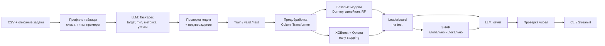

# AutoML: архитектура и план

## 1. Что мы строим

Небольшой AutoML-инструмент, в центре которого **XGBoost**, и **LLM-слой** вокруг него.

Пользователь загружает CSV и описывает задачу своими словами, например «хочу понять, какие клиенты уйдут». Дальше система:

1. **Понимает задачу (LLM).** По схеме таблицы предлагает целевой столбец, тип задачи и метрику, предупреждает о столбцах-утечках. Код проверяет предложение, пользователь подтверждает.
2. **Обучает модели честно (код, без LLM).** Сначала простые базовые модели, затем XGBoost с подбором гиперпараметров через Optuna и early stopping на валидации, финальная оценка на отложенной выборке.
3. **Объясняет результат.** SHAP показывает, какие признаки важны вообще и почему конкретная строка получила такой прогноз.
4. **Пишет отчёт (LLM).** Понятный текст по готовым цифрам. Каждое число в отчёте проверяется по исходным результатам.

**Для кого проект:** портфолио на роль **AI engineer**.

**Что это доказывает работодателю:**
- понимание gradient boosting изнутри (своя реализация с нуля) и уверенная работа с XGBoost;
- честное ML: правильная валидация, без утечек, сравнение с базовыми моделями, воспроизводимость;
- встраивание LLM в продукт: структурированный вывод, проверка ответов модели, оценка качества (evals);
- инженерная культура: тесты, CI, линтер, понятный README, демо по ссылке.

**Личная цель:** разобраться в XGBoost и gradient boosting.

## 2. Цели, не-цели, анти-цели

**Цели:**
- работает на любой табличной задаче классификации (бинарной и многоклассовой) и регрессии из CSV;
- на бенчмарке из 5–8 открытых датасетов XGBoost-конвейер стабильно обходит простые базовые модели, и это видно в таблице;
- LLM правильно определяет целевой столбец и тип задачи на наборе eval-кейсов, и точность измерена;
- демо открывается по ссылке без установки.

**Не-цели:**
- конкурировать с AutoGluon, H2O или FLAML по качеству моделей;
- десятки алгоритмов: только базовые модели и XGBoost (LightGBM, может быть, позже);
- временные ряды, тексты, изображения;
- большие данные: ориентир до ~1 млн строк в памяти.

**Анти-цели** (провал, даже если всё «работает»):
- LLM выбирает гиперпараметры или выдумывает метрики;
- сырые данные пользователя уходят в LLM: отправляем только схему, типы и несколько примеров значений;
- отчёт содержит числа, которых нет в результатах;
- лучшая модель выбирается по той же выборке, на которой потом показывается её качество;
- код, который работает только в ноутбуке.

## 3. Чему учимся у vladyslavzk/automl

Оригинальный репозиторий хорошо структурирован, но в нём есть ошибки, которые мы не должны повторить:

| Проблема в оригинале | Как делаем мы |
|---|---|
| Для `neg_mean_squared_error` выбрано `direction='minimize'`: регрессия оптимизируется в обратную сторону | Optuna всегда максимизирует sklearn-score, направление покрыто тестом |
| В пространстве XGBoost `reg_alpha` задан с `low=0, log=True`: Optuna падает, XGBoost не обучается | Пространства поиска валидируются тестом: каждое испытание запускается хотя бы раз |
| Строковые метки классов не перекодируются, XGBoost на них падает | `LabelEncoder` для целевой переменной, обратное преобразование при предсказании |
| `max_depth` случайно заменяется на `None` через `np.random` мимо Optuna | Все случайные решения проходят через `trial` и фиксированный seed |
| Early stopping LightGBM считается по обучающей выборке | Early stopping только на отдельной валидационной выборке |
| Важность признаков склеивается с исходными именами столбцов, хотя после One-Hot их больше | Имена признаков берутся из `ColumnTransformer.get_feature_names_out()` |
| Столбцы `category`/`bool`/datetime молча отбрасываются | Явная классификация типов столбцов, неподдержанные столбцы попадают в отчёт |
| Вещественная цель с <50 уникальными значениями считается классификацией | Эвристика учитывает тип (float → регрессия) и даёт уверенность; LLM и пользователь могут переопределить |
| `MedianPruner` без промежуточных значений бесполезен | Прунинг через промежуточные значения XGBoost или без прунинга |

## 4. Архитектура



**Главное правило:** LLM работает только на входе (текст → `TaskSpec`) и на выходе (результаты → текст). Всё, что посередине, детерминировано и покрыто тестами. Ядро работает и без LLM: `TaskSpec` можно передать руками.

**Структура пакета `automl`:**

```
src/automl/
  data/        профиль таблицы, типы столбцов, загрузка датасетов
  task.py      TaskSpec (pydantic): target, problem_type, metric, drop_columns
  preprocess.py
  boosting/    своя реализация gradient boosting (учебная)
  models/      базовые модели, XGBoost-обёртка, пространства поиска
  search.py    Optuna, бюджет времени
  evaluate.py  метрики, leaderboard
  explain.py   SHAP
  llm/         клиент, промпты, TaskSpec из LLM, отчёт, проверка чисел
  cli.py
app/           Streamlit
evals/         eval-кейсы для LLM
benchmarks/    бенчмарк на открытых датасетах
```

## 5. Стек

Python 3.12, uv, pandas, scikit-learn, **XGBoost**, **Optuna**, **SHAP**, pydantic, Anthropic SDK (Claude), Typer для CLI, Streamlit для демо, pytest, ruff, GitHub Actions.

Датасеты для бенчмарка и evals берём из OpenML через `sklearn.datasets.fetch_openml`: например Adult, Bank Marketing, Telco Churn, credit-g, California Housing, Ames House Prices. Кэшируем локально в `data/` (не коммитим).

## 6. Этапы

Каждый этап заканчивается работающим кодом, тестами и коммитом.

### Этап 0. Каркас
- uv-проект, пакет `automl`, ruff, pytest, pre-commit;
- GitHub Actions: lint + тесты;
- короткий README на английском (полная версия на этапе 9).

**Готово, когда:** `uv run pytest` и `uv run ruff check .` зелёные локально и в CI.

### Этап 1. Gradient boosting с нуля (учебный)

**1a. Классический gradient boosting** — готово (2026-11-03).
- `boosting/from_scratch.py`: регрессия (MSE) и бинарная классификация (log-loss) на NumPy поверх `DecisionTreeRegressor`: начальное предсказание, псевдо-остатки, шаг Ньютона в листьях, learning rate, subsample, `staged_predict`;
- тесты: предсказания совпадают со sklearn `GradientBoostingRegressor`/`Classifier` с теми же параметрами, loss при обучении падает, строковые метки, валидация параметров;
- `scripts/compare_boosting.py`: сравнение со sklearn и XGBoost по качеству и скорости, кривая ошибки на test для двух learning rate.

**1b. Мини-XGBoost** — готово (2026-11-03).
- `boosting/mini_xgboost.py`: своё дерево вместо `DecisionTreeRegressor`; точный (exact) поиск разбиения по gain из градиентов и гессианов, вес листа `-G / (H + lambda)`, L1 `reg_alpha`, `gamma` с прунингом снизу вверх, `min_child_weight`, пропуски с направлением по умолчанию (включая разбиение «пропуск против остальных»), `subsample`, `colsample_bytree`, `to_text()` для просмотра дерева;
- тесты: формулы на примере, который считается вручную; предсказания совпадают с `xgboost` (`tree_method="exact"`) до точности float32 для регрессии и классификации, с `gamma`, L1/L2, `min_child_weight` и пропусками.

**1c. Ноутбук** — готово (2026-11-03). `notebooks/01_boosting_from_scratch.ipynb` (англ., выполняется ~50 с): сумма деревьев на синусоиде, learning rate и число деревьев, переобучение, early stopping на валидации, глубина деревьев, `gamma` и `reg_lambda`, дерево через `to_text()`, скорость mini-xgb / xgb exact / xgb hist.

**Выводы для ядра (этап 3):** `tree_method="hist"`; число деревьев выбирает early stopping на валидационной выборке, не на test; регуляризацию и число деревьев подбирать вместе; диапазон `gamma` масштабировать под целевую переменную (gain измеряется в квадратах градиента).

### Этап 2. Данные и спецификация задачи — готово (2026-11-03)
- `data/profile.py`: `profile_dataset(df)` → тип каждого столбца (numeric, boolean, categorical, datetime; не используются: id_like, text, constant, empty) с причиной; доля пропусков, уникальные, до 5 примеров, статистики; `to_dict()` — компактный профиль для LLM без строк данных. «Одно значение + пропуски» — не константа, а флаг заполненности;
- `data/leakage.py`: (1) каждый столбец отдельно через дерево и 3-fold CV — при ROC AUC / balanced accuracy / R² ≥ 0.97 столбец удаляется как утечка; (2) «заполненность указывает на класс» (≥99% одного класса на ≥5% строк) — предупреждение, решает человек или LLM;
- `task.py`: `TaskSpec` (pydantic: target, problem_type, metric, drop_columns с причинами, notes), `check_against(df)` перечисляет все несоответствия; `infer_task_spec` без LLM; float-цель всегда регрессия, целое ≤ 10 значений — мультикласс с пометкой;
- `preprocess.py`: `plan_features` (каждый столбец либо в признаках, либо в `ignored` с причиной), `make_preprocessor` в двух вариантах: для деревьев (числа как есть, NaN остаются) и для линейных моделей (медиана + флаг пропуска + стандартизация); One-Hot до 20 уровней с уровнем «пропуск»; даты → год, месяц, день, день недели, час; выход — DataFrame с именами признаков;
- `split.py`: train/valid/test (60/20/20) со стратификацией, `LabelEncoder` для классов, строки без целевого значения пропускаются;
- CLI: `automl profile data.csv [--target col] [--json]`.

**Проверено на реальных данных** (OpenML, кэш в `data/`): Titanic — `boat` удалён как утечка (AUC 0.973), на `body` предупреждение (заполнен только у погибших), `name` — id_like; Adult (48 842 строки) — ни одного ложного срабатывания, 6 с.

Замечание: `fetch_openml` в sklearn 1.9 с pandas 3 падает на парсере по умолчанию — использовать `parser="liac-arff"`.

### Этап 3. AutoML-ядро — готово (2026-11-03)
- `metrics.py`: единое правило «больше — лучше» для оптимизации (`objective()` переворачивает потери), отчёты в естественных единицах; классификационные метрики считаются по вероятностям;
- `models.py`: кандидаты dummy → linear (сила регуляризации подбирается на valid) → random_forest → xgboost_default → xgboost (Optuna TPE, `direction="maximize"`); early stopping на valid (до 2000 деревьев, 50 раундов терпения); у всех лог-диапазонов `low > 0`; `gamma` задаётся долей от числа строк (gain — сумма по строкам); цель регрессии для XGBoost стандартизируется;
- `engine.py`: `AutoML(...).fit(df, target)` — задача → разбиение → тюнинг на train/valid → **выбор по valid** → переобучение каждого кандидата на train+valid (число деревьев масштабируется) → **test один раз** → leaderboard; `FittedModel` (Pipeline preprocess+model, классы, метаданные), `save`/`load_model` (joblib);
- CLI: `automl fit data.csv --target col --time-budget 120`, `automl predict model.joblib new.csv`.

**Результаты:** Titanic — xgboost 0.904 ROC AUC на test (логистическая 0.904, RF 0.891); Adult — xgboost 0.930 против 0.927 у XGBoost по умолчанию и 0.906 у логистической.

**Известное ограничение:** на маленьких данных (сотни строк) одна валидационная выборка шумная: 30+ испытаний Optuna подстраиваются под неё (на синтетике 400 строк: valid 0.87, test 0.63, логистическая лучше на test). Leaderboard это честно показывает. Исправление — на этапе 5: для малых данных выбирать по кросс-валидации и проверить на бенчмарке.

### Этап 4. Объяснимость — готово (2026-11-04)
- `explain.py`: `explain(model, df) -> Explanation` для любой выбранной модели, всегда точно: XGBoost — встроенный TreeSHAP (`pred_contribs`, log-odds), random forest — `shap.TreeExplainer` (вероятность), линейные — коэффициент × (значение − среднее), dummy — нули; регрессия XGBoost переводится из стандартизованной шкалы обратно в единицы цели;
- вклады one-hot признаков, частей дат и флагов пропуска суммируются обратно в исходный столбец (`contract`, а не `contract_one year`);
- `Explanation`: `importance()` (глобально, mean |SHAP|), `row(i)` и `describe_row(i)` (локально), `to_dict()` для отчёта/LLM; мультикласс объясняет предсказанный класс;
- `plots.py`: важность столбцов и объяснение строки (красный — вверх, синий — вниз, знак подписан у каждого столбика); matplotlib через `Figure` без GUI;
- `AutoML.fit` сохраняет сводку важности на test в метаданных модели; `models_` хранит все переобученные кандидаты;
- CLI: `automl explain model.joblib data.csv --row 3 --out-dir artifacts/explain`;
- тесты: база + сумма вкладов = выход модели для всех 5 типов моделей × бинарная/мультикласс/регрессия.

**Находка на Titanic:** `body` (предупреждение этапа 2, не удалён) — 5-й по важности столбец, а у погибшего пассажира с `body = 135` он даёт −2.64 log-odds — больше, чем пол. SHAP подтверждает утечку; решать такие случаи по смыслу столбца — задача LLM-слоя (этап 6).

### Этап 5. Бенчмарк
- `benchmarks/run.py` на 5–8 датасетах OpenML: Dummy vs линейная vs RF vs XGBoost по умолчанию vs XGBoost + Optuna;
- несколько seed, среднее и разброс; результат в `benchmarks/results.md`;
- честно описать, где тюнинг почти ничего не дал.

### Этап 6. LLM: понимание задачи
- профиль таблицы + описание пользователя → `TaskSpec` через структурированный вывод Claude;
- проверка кодом: столбец существует, тип задачи совместим с целевой переменной, метрика допустима; при ошибке — повторный запрос с текстом ошибки;
- подсказки об утечках (ID-столбцы, даты после события, столбцы, почти равные целевой);
- ядро продолжает работать без ключа API (эвристика из этапа 2).

### Этап 7. LLM: отчёт
- результаты (leaderboard, метрики, SHAP) → JSON с фактами → отчёт в Markdown;
- проверка чисел: каждое число в отчёте должно найтись в фактах (с округлением), иначе перегенерация или пометка;
- аудитория отчёта: не-ML-специалист.

### Этап 8. Evals
- `evals/cases/`: 10–15 кейсов (датасет + описание задачи + ожидаемые target, тип задачи, столбцы-утечки);
- метрики: точность target, точность типа задачи, recall по утечкам, доля отчётов, прошедших проверку чисел;
- запуск `uv run python -m evals.run`, результаты в `evals/results.md`, сравнение промптов и моделей.

### Этап 9. Демо и упаковка
- Streamlit: загрузка CSV → описание → подтверждение TaskSpec → обучение с прогрессом → leaderboard, SHAP, отчёт;
- деплой на Streamlit Community Cloud; без ключа API демо работает на заранее посчитанных примерах;
- README для рекрутеров на английском: что это, демо, скриншоты, архитектура, бенчмарк, evals, решения (ADR);
- тексты для CV (EN).

### Этап 10 (позже). Чат с результатом
- tool calling: «почему клиент №123 в зоне риска?» → LLM вызывает функции проекта (найти строку, SHAP для строки, сравнить с похожими) и отвечает;
- свои eval-кейсы для чата.

## 7. Открытые вопросы

- Название репозитория на GitHub: `AutoML`?

**Решено:** учебные части пишутся с подробными комментариями, которые объясняют каждый шаг; сроков нет, работаем этапами по порядку.
